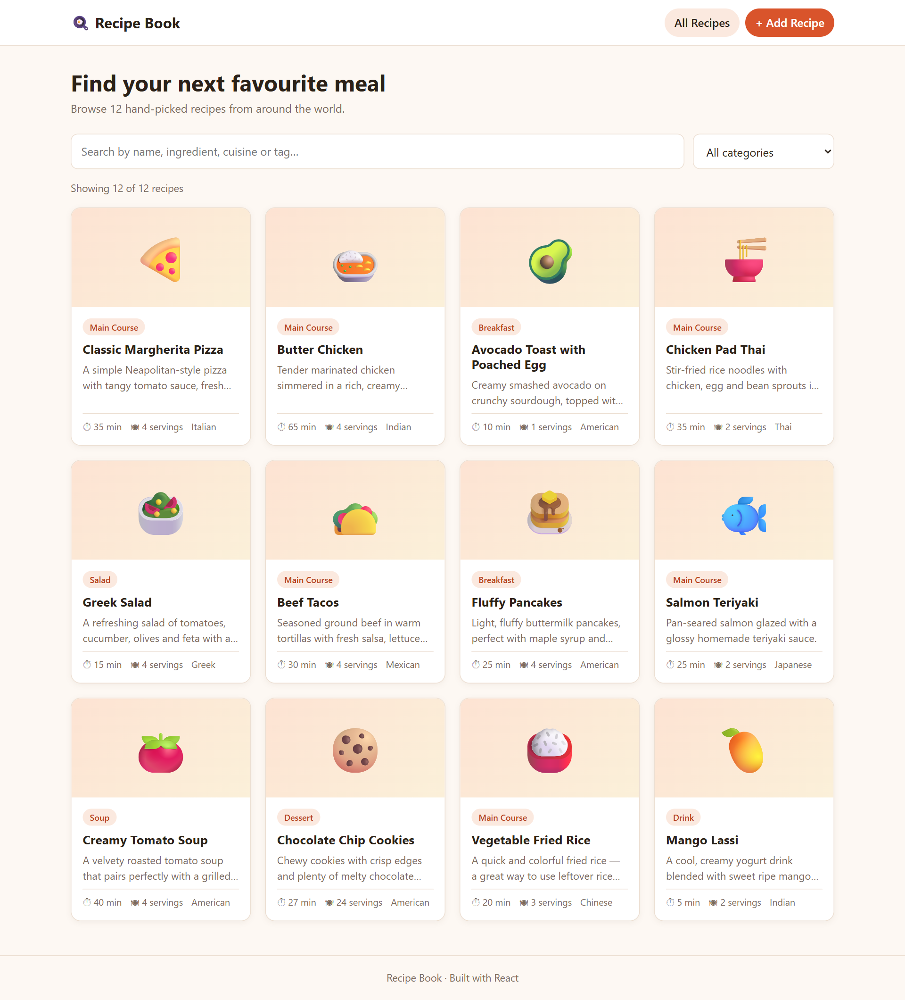
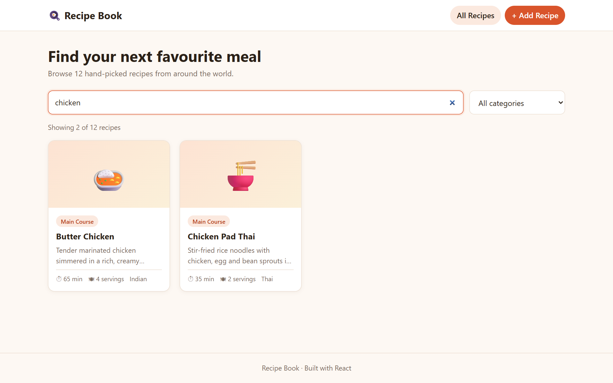
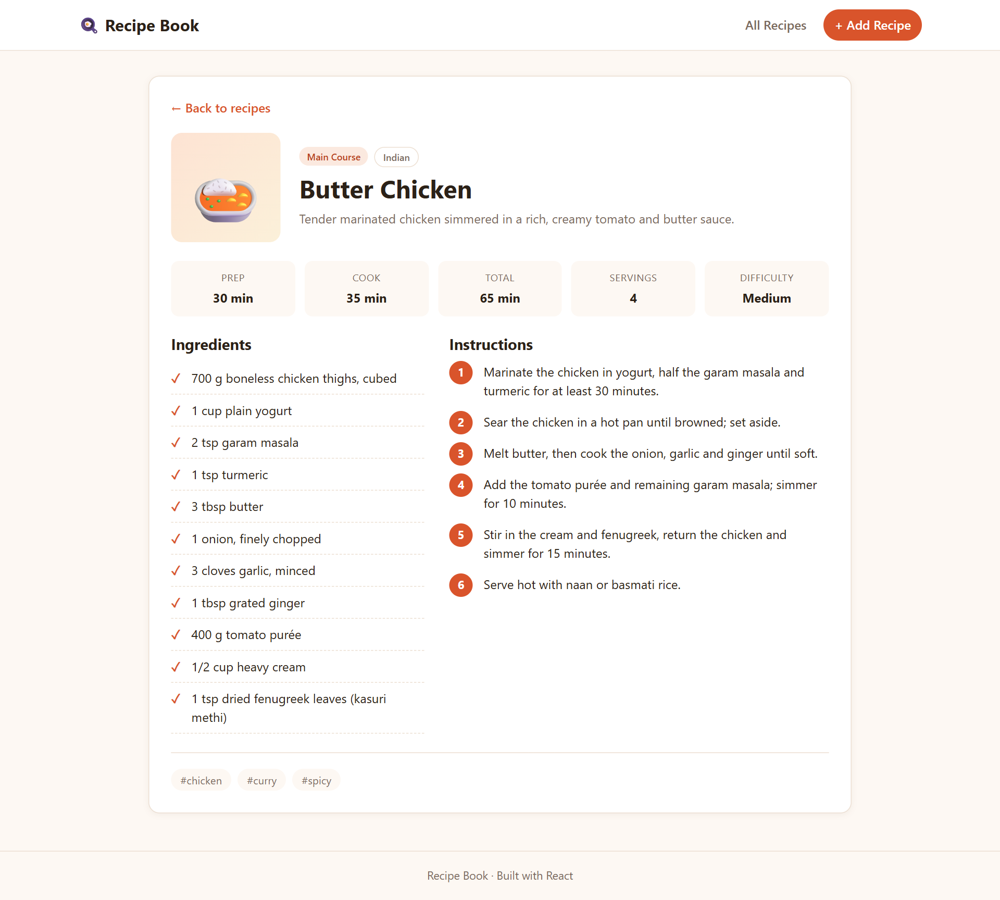
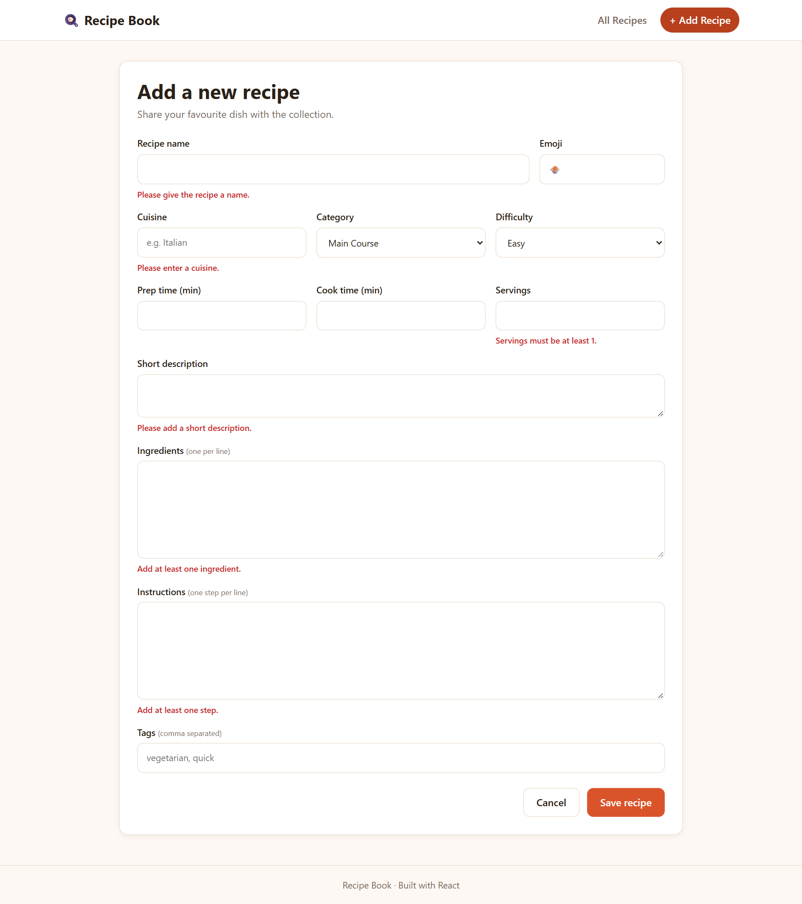
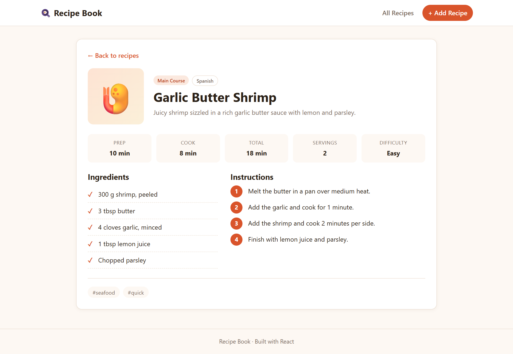
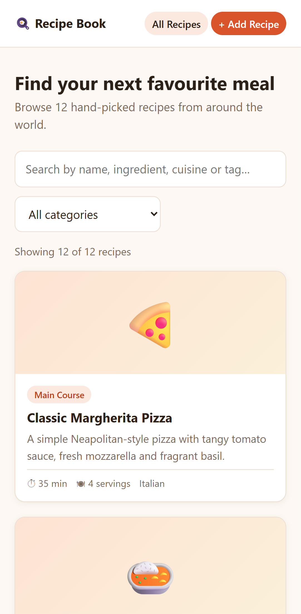
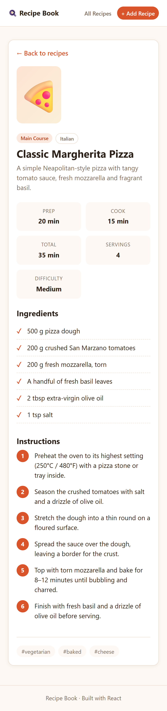
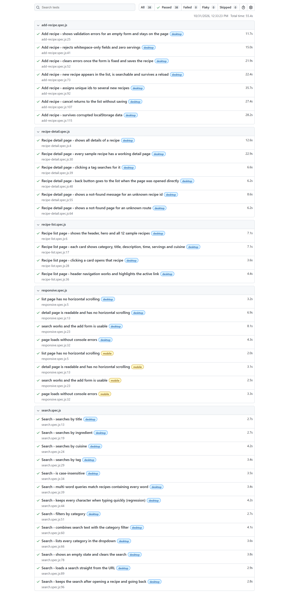

<div align="center">

# 🍳 Recipe Book

**A simple, friendly recipe app: browse dishes from around the world, search by anything, and add your own.**

[](https://react.dev)
[](https://reactrouter.com)
[](https://vite.dev)
[](#-testing)
[](https://oxc.rs)



[Features](#-features) · [Screenshots](#-screenshots) · [Getting started](#-getting-started) · [How it works](#-how-it-works) · [Testing](#-testing) · [Project structure](#-project-structure)

</div>

---

## About

Many recipe sites are cluttered with ads, long stories and too many options. **Recipe Book** keeps only what matters: a clean list of recipes, a clear detail card for each one, fast search, and a form for adding your own favourites.

It was built as *Course-end Project 2: Developing a Recipe App Using Gen AI-Assisted Code Generation*.

## ✨ Features

| | Feature | Details |
|---|---|---|
| 📋 | **Recipe list** | Every recipe as a card with category, description, total time, servings and cuisine, in a grid that adapts to any screen |
| 🔍 | **Smart search** | Searches names, descriptions, cuisines, categories, tags **and ingredients**. Multi-word searches like `chicken noodles` match recipes containing every word |
| 🏷️ | **Category filter** | Narrow results to Breakfast, Main Course, Salad, Soup, Dessert or Drink, alone or combined with a search |
| 🔗 | **Shareable searches** | The search is kept in the URL (`/?q=chicken&category=Main%20Course`), so it survives a refresh, going back, or sharing the link |
| 📖 | **Recipe detail card** | Prep, cook and total time, servings, difficulty, an ingredient checklist, numbered steps, and tags that link to a search |
| ➕ | **Add your own recipes** | A validated form whose errors clear as you type. New recipes are saved in your browser and still there tomorrow |
| 📱 | **Responsive** | Works on phones, tablets and desktops |
| 🧭 | **Helpful edge cases** | Friendly "Not found" pages, a "Clear search" button when nothing matches, and every page opens at the top |

The app comes with **12 sample recipes from 8 cuisines**: Italian, Indian, American, Thai, Greek, Mexican, Japanese and Chinese.

## 📸 Screenshots

<table>
  <tr>
    <td width="50%"><br><sub><b>Search</b>: "chicken" finds 2 recipes</sub></td>
    <td width="50%"><br><sub><b>Recipe detail</b>: times, ingredients and numbered steps</sub></td>
  </tr>
  <tr>
    <td width="50%"><br><sub><b>Add a recipe</b>: errors appear under each missing field</sub></td>
    <td width="50%"><br><sub><b>Your recipe</b>: saved and ready to cook</sub></td>
  </tr>
</table>

<details>
<summary><b>📱 Mobile view</b></summary>
<br>
<p align="center">
  
  &nbsp;&nbsp;
  
</p>
</details>

## 🚀 Getting started

### Prerequisites

- [Node.js](https://nodejs.org) 20.19+ or 22.12+ (includes npm)
- [Google Chrome](https://www.google.com/chrome/), only needed to run the end-to-end tests

### Install and run

```bash
# 1. Clone the repository and open the app folder
git clone https://github.com/kommineninikhil09-lab/FSD_Recipe-App.git
cd FSD_Recipe-App/recipe-app

# 2. Install dependencies
npm install

# 3. Start the development server
npm run dev
```

Open the URL shown in the terminal (usually <http://localhost:5173>) and start cooking. 🍝

### Available scripts

Run these from the `recipe-app` folder.

| Command | What it does |
|---|---|
| `npm run dev` | Start the development server with hot reload |
| `npm run build` | Create an optimised production build in `dist/` |
| `npm run preview` | Preview the production build locally |
| `npm run lint` | Check the code with oxlint |
| `npm run test:e2e` | Run all 42 end-to-end tests in Chrome |

## 🧠 How it works

### Pages

| Route | Page | Component |
|---|---|---|
| `/` | All recipes, search and filter | `RecipeList` |
| `/recipes/:id` | One recipe in detail | `RecipeDetail` |
| `/add` | Add a new recipe | `AddRecipeForm` |
| anything else | Not found | `NotFound` |

### Recipe data

Each recipe in [`src/data/recipes.js`](recipe-app/src/data/recipes.js) has the same shape:

```js
{
  id: 1,
  title: 'Classic Margherita Pizza',
  emoji: '🍕',
  cuisine: 'Italian',
  category: 'Main Course',
  difficulty: 'Medium',          // Easy | Medium | Hard
  prepTime: 20,                  // minutes
  cookTime: 15,                  // minutes
  servings: 4,
  description: 'A simple Neapolitan-style pizza with tangy tomato sauce...',
  ingredients: ['500 g pizza dough', '200 g crushed San Marzano tomatoes', ...],
  instructions: ['Preheat the oven to its highest setting...', ...],
  tags: ['vegetarian', 'baked', 'cheese'],
}
```

To add more built-in recipes, append objects to this array with a unique `id`.

### Search

A recipe matches when **every word** you type appears somewhere in its text, ignoring capitals:

```js
function matchesQuery(recipe, query) {
  const haystack = [recipe.title, recipe.description, recipe.cuisine,
    recipe.category, ...recipe.tags, ...recipe.ingredients].join(' ').toLowerCase()

  return query.toLowerCase().split(/\s+/).filter(Boolean)
    .every((word) => haystack.includes(word))
}
```

| You type | You get |
|---|---|
| `pizza` | Classic Margherita Pizza |
| `feta` | Greek Salad (found through its ingredients) |
| `indian` | Butter Chicken, Mango Lassi |
| `chicken noodles` | Chicken Pad Thai only |

### Saving your recipes

Recipes you add are stored in the browser's `localStorage` under the key `recipe-app:custom-recipes` and merged with the built-in ones. They stay between visits on the same browser. If that saved data is ever corrupted, the app ignores it instead of crashing.

## 🧪 Testing

The app has **42 end-to-end tests** written with [Playwright](https://playwright.dev). They click through the app in real Google Chrome, at desktop size and on a mobile screen (Pixel 7).

```bash
npm run test:e2e              # run every test
npx playwright show-report    # open the HTML report
npx playwright test --ui      # watch tests run step by step
```

| Test file | Tests | Covers |
|---|:---:|---|
| `recipe-list.spec.js` | 4 | Recipe grid, card details, navigation |
| `search.spec.js` | 13 | Search by name, ingredient, cuisine and tag; filters; empty results; search kept in the URL; fast typing |
| `recipe-detail.spec.js` | 6 | Every field on the detail card, all 12 recipes, tag links, back button, not-found pages |
| `add-recipe.spec.js` | 9 | Validation, saving, persistence after reload, unique ids, cancel, corrupted saved data |
| `responsive.spec.js` | 5 × 2 | No sideways scrolling, header layout, no console errors, on desktop **and** mobile |

<details>
<summary><b>📊 Test report</b></summary>
<br>

</details>

### Capturing screenshots

[`scripts/capture-screenshots.mjs`](recipe-app/scripts/capture-screenshots.mjs) captures a screenshot of every feature from a running dev server:

```bash
npm run dev   # in one terminal
node scripts/capture-screenshots.mjs http://localhost:5173 screenshots   # in another
```

## 📁 Project structure

```
FSD_Recipe-App/
├── recipe-app/                       # The React app
│   ├── src/
│   │   ├── main.jsx                  # App entry point
│   │   ├── App.jsx                   # Routes and recipe state (built-in + user-added)
│   │   ├── App.css                   # Layout, cards, forms, responsive rules
│   │   ├── index.css                 # Global styles and theme colours
│   │   ├── data/
│   │   │   └── recipes.js            # 12 sample recipes
│   │   └── components/
│   │       ├── Header.jsx            # Logo and navigation
│   │       ├── RecipeList.jsx        # List page with search and filter
│   │       ├── SearchBar.jsx         # Search box and category dropdown
│   │       ├── RecipeCard.jsx        # One card in the grid
│   │       ├── RecipeDetail.jsx      # Full recipe detail card
│   │       ├── AddRecipeForm.jsx     # Form for adding recipes
│   │       ├── NotFound.jsx          # Missing recipe / unknown page
│   │       └── ScrollToTop.jsx       # Scrolls up when the page changes
│   ├── e2e/                          # Playwright end-to-end tests
│   ├── scripts/
│   │   └── capture-screenshots.mjs   # Screenshot capture
│   ├── docs/screenshots/             # Images used in this README
│   ├── playwright.config.js
│   └── vite.config.js
└── submission/                       # Project submission files
    ├── Writeup.pdf                   # Project report
    ├── Screenshots.pdf               # Captioned screenshots of every feature
    └── screenshots/                  # Individual screenshot images
```

📄 The project report is in [`submission/Writeup.pdf`](submission/Writeup.pdf) and the screenshots are in [`submission/Screenshots.pdf`](submission/Screenshots.pdf).

## 🛠️ Tech stack

| Tool | Used for |
|---|---|
| [React 19](https://react.dev) | User interface |
| [React Router 7](https://reactrouter.com) | Page navigation and URL search parameters |
| [Vite 8](https://vite.dev) | Development server and production build |
| [Playwright](https://playwright.dev) | End-to-end testing |
| [oxlint](https://oxc.rs) | Linting |
| Plain CSS | Styling with CSS variables, grid and flexbox, with no UI library |

The project was scaffolded with:

```bash
npx create-vite@latest recipe-app --template react
```

## 🗺️ Ideas for the future

- [ ] Edit and delete your own recipes
- [ ] Mark favourites
- [ ] Scale ingredient amounts by number of servings
- [ ] Real food photos instead of emoji
- [ ] Sort by cooking time or difficulty

---

<div align="center">
<sub>Built with React · Course-end Project 2</sub>
</div>
